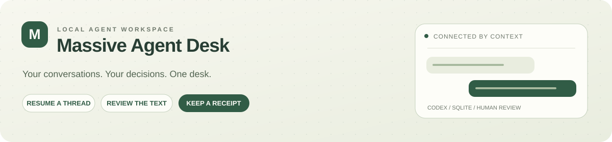
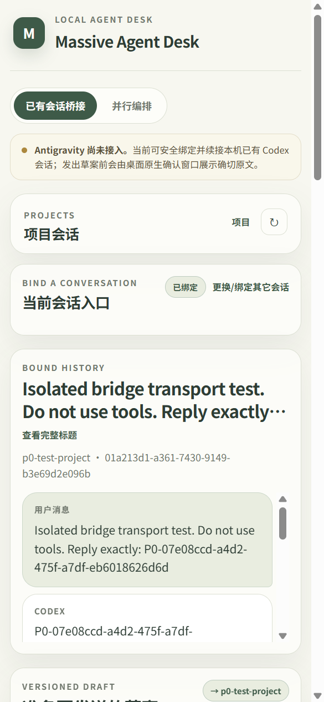
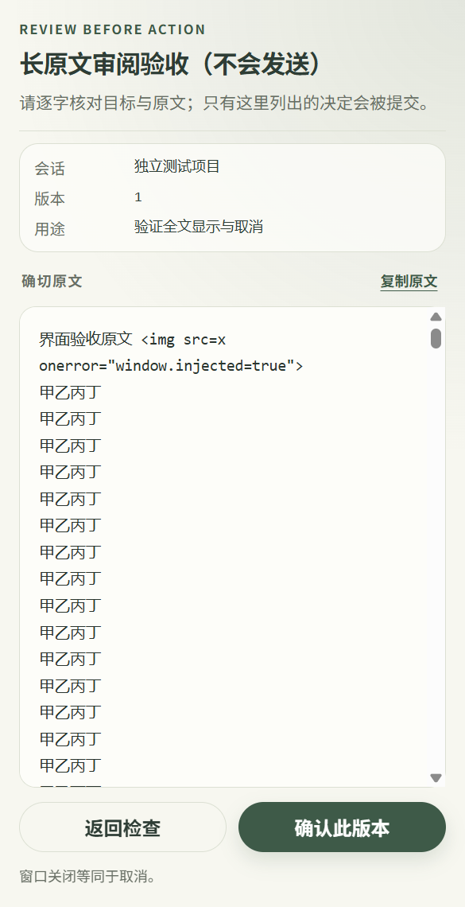
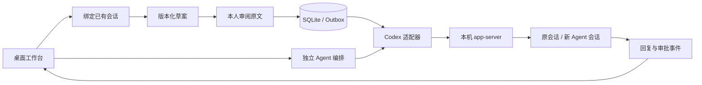

<p align="center">
  
</p>

<p align="center">
  <strong>续接已有对话，核对确切原文，让每一次派工留下回执。</strong><br />
  Electron · SQLite · Codex App Server
</p>

<p align="center">
  <a href="#preview">界面预览</a> · <a href="#quick-start">快速开始</a> · <a href="#status">开发状态</a> ·
  <a href="docs/antigravity-mobile-bridge-plan.md">施工规划</a> · <a href="docs/p0-implementation-status.md">验证记录</a>
</p>

Massive Agent Desk 是一个本地优先的桌面 Agent 工作台。当前支持绑定本机已有 Codex 会话，保存版本化草案，经独立审阅窗口确认后续接原对话；也保留了为 1–8 个独立 Agent 配置角色、模型与推理强度的并行编排入口。

> **开发中的原型 · 尚未达到完整 P0 验收。** 本分支包含最新桌面桥接实现。Antigravity 已完成 CLI/ACP 能力探测，原会话接入仍等待登录与指定测试会话；Android APK、跨网配对和锁屏通知尚未交付。

<a id="preview"></a>
## 界面预览

采用 DSH-Go 风格的圆角、胶囊控件与克制留白，配合 [coisni2333.com](https://coisni2333.com) 博客本地样式中的米白、灰绿配色。截图来自真实 Electron 渲染与独立测试会话。


<details>
<summary><strong>查看窄屏布局与长原文审阅窗口</strong></summary>
<br />
<table>
  <tr><th>390px 响应式布局</th><th>独立原文审阅</th></tr>
  <tr>
    <td></td>
    <td></td>
  </tr>
</table>

窄屏截图是桌面应用的响应式预览，**不是 Android APK 或真机截图**。审阅窗口验收使用测试文本，脚本只自动选择取消。
</details>

## 当前可以做什么

| 能力 | 当前行为 |
|---|---|
| 续接已有会话 | 按目录发现历史，显式绑定稳定会话 ID；保留原会话模型与推理配置 |
| 版本化草案 | 保存确切全文、版本与 SHA-256；编辑后使旧的未发送版本失效 |
| 独立审阅 | 查看目标、版本与完整原文；关闭审阅窗口即取消 |
| 持久发送记录 | SQLite 保存确认与 outbox；区分待发送、Codex 已接收和发送结果未知 |
| 部分本人审批 | 展示命令或文件修改原文，按原请求 ID 回答本次允许、拒绝或终止 |
| 独立 Agent 编排 | 配置 1–8 个 Agent、八种角色预设、模型与 reasoning effort |
| 个人工作配置 | 附带全局 AGENTS.md、角色 TOML 和可复用 Skill |

**“Codex 已接收”不等于任务完成。** 回执未知的命令会保持锁定，不能盲目重发；同一目标忙碌时，其它已确认命令留在队列中。

<a id="quick-start"></a>
## 快速开始

当前主要验证环境为 **Windows 11、Node.js 24.16.0、Electron 38.8.6**。本地测试使用 `node:sqlite`，应用运行时使用 Electron 内置的 Node.js。还需要可用且已登录的 Codex CLI。

```powershell
git clone --branch codex/mobile-bridge-p0 https://github.com/coisini233333333/massive-agent-desk.git
cd massive-agent-desk
npm install
npm test
npm start
```

仓库为私有仓库，克隆需要对应的 GitHub 访问权限。如果 `codex.exe` 无法自动发现，可在当前终端指定路径：

```powershell
$env:CODEX_CLI_PATH = 'C:\path\to\codex.exe'
npm start
```

### 第一次使用

1. 在“已有会话桥接”页选择项目目录，查找该目录下的 Codex 会话。
2. 显式绑定要续接的会话，查看其历史与目标标识。
3. 输入草案并保存版本，点击“查看并确认发送”。
4. 在独立审阅窗口核对全文和目标，再决定是否发送。
5. 查看回执及后续对话；需要新建独立 Agent 时，切换到“并行编排”页。

应用配置、绑定与派工数据保存在 Electron `userData` 下的 `orchestrator.json` 和 `bridge.sqlite`。Codex 登录由其自身管理，应用不把令牌写入项目配置。

## 工作方式



已有会话入口通过持久登记管理原文确认和回执；独立编排保留原有运行计划。自动 worktree 隔离、监工交接与多模型协作仍在规划中。

## 验证与复现

当前本地测试 **37 项通过**，覆盖绑定竞态、草案事务回滚、确认版本、防重复发送、审批路由与连接恢复等行为。真实 Codex 往返和界面验收的范围见 [实施记录](docs/p0-implementation-status.md)；这些结果不是完整产品验收，也不是云端 CI 状态。

| 命令 | 用途与边界 |
|---|---|
| `npm test` | 本地单元与集成逻辑测试，不启动模型任务 |
| `npm run smoke:codex` | 真实 app-server 握手与模型发现 |
| `npm run smoke:bridge-codex` | 创建专用测试会话，发送两条短消息，验证同一 ID 续接 |
| `npm run smoke:bridge-host` | 续用上一步的测试会话，验证持久派工与准确回复；确认回调为测试替身 |
| `npm run smoke:ui` | 隔离配置目录的空状态桌面/窄屏截图 |
| `npm run smoke:ui:bridge` | 使用已有 Codex 测试记录验证桥接 UI、目录检索失败后的恢复及截图 |
| `npm run smoke:review` | 验证 50,000 字符原文、纯文字渲染、决定白名单与取消 |
| `npm run probe:antigravity` | 仅探测 ACP 初始化能力，不创建 Agent 会话 |
| `npm run validate:skill` | 验证仓库内 Skill 的结构 |

真实模型 smoke 会使用当前 Codex 账户。模型重试期间请保留原进程，不要因观察超时创建替代任务。界面与审阅测试会故意触发拒绝路径，预期错误后应以最终退出码及验收结果为准。

Antigravity 探针默认查找本地忽略目录中的 CLI，也可通过 `ANTIGRAVITY_CLI_PATH` 指定。干净克隆不包含该可执行文件，安装方式参见 [Google 官方指南](https://antigravity.google/docs/getting-started?tab=cli)。

<a id="status"></a>
## 开发状态

| 阶段 | 进展 |
|---|---|
| **P0 · 原会话原型** | Codex 续接、持久派工与桌面 UI 已有证据；Antigravity 原会话及其本人确认来源受登录/测试会话依赖阻塞 |
| **P1 · 桌面核心** | 部分绑定、草案、回执与审批已实现；持久项目事件、完整对账和交接仍待实现 |
| **P2 · 并行协作** | 两个正式 work 的协同验收、监工切换与上下文交接待实现 |
| **P3 · Android APK** | 配对、跨网通道、锁屏通知、安装包与真机测试待实现 |
| **P4 · 端到端** | 从原会话确认到手机通知、离线恢复和重启恢复的整体验收尚未完成 |

详细约束与验收条件见 [施工规划](docs/antigravity-mobile-bridge-plan.md)。当前不提供 APK 或 Windows 安装包；一般用户提问的作答 UI、`unknown` 状态的人工对账与解锁也尚未完成。

## 个人 Agent 配置

仓库附带 [全局配置](global-config) 和 [design-personal-agent-team Skill](skills/design-personal-agent-team/SKILL.md)。角色模型是预设值，实际可用模型以当前 Codex 运行时为准。

| 角色 | 预设模型 | 负责内容 |
|---|---|---|
| `research_scout` | GPT-5.6 Luna | 论文、官方文档、GitHub 与先验证据 |
| `scientific_reasoner` | GPT-5.6 Sol | 公式、机制、实验设计与严谨综合 |
| `ml_experimenter` | GPT-5.6 Terra | PyTorch、生成模型、训练与评估 |
| `fpga_embedded_engineer` | GPT-5.6 Terra | RTL、时序、协议与嵌入式验证 |
| `analog_instrumentation_engineer` | GPT-5.6 Terra | 模拟/RF、ADC/DAC 与仪器 |
| `software_builder` | GPT-5.6 Terra | 桌面/全栈、调度与适配器 |
| `verification_reviewer` | GPT-5.6 Sol | 正确性、回归与证据审查 |
| `technical_writer` | GPT-5.6 Luna | 报告、Word/PDF/幻灯片与视觉质检 |

安装脚本会修改个人全局配置，并为现有文件创建时间戳备份。需要安装这套团队配置时，手动运行：

```powershell
powershell -ExecutionPolicy Bypass -File .\global-config\install.ps1
```

全局团队配置的默认并发上限为 6；桌面独立编排页的数量范围为 1–8。

## 项目导航

```text
src/main/          Codex 连接、绑定、SQLite 派工登记与审阅宿主
src/renderer/      桌面桥接与独立 Agent 编排界面
src/review/        独立原文审阅界面
src/shared/        角色预设与运行计划
test/              回归测试
scripts/           接口探针与 smoke 验收
docs/              施工规划、实施记录与视觉资源
artifacts/         已提交的测试证据与界面截图
global-config/     可安装的个人团队配置
skills/            可复用 Skill
```

## 数据与权限

- 当前通过本机 stdio 连接 Codex app-server，尚未开放手机网络服务。
- 草案、绑定与回执留在本机；模型请求及工具访问遵循当前 Codex 账户、会话和权限配置。
- 确认绑定具体目标与原文版本；普通模型消息不能替代本人审阅决定。
- 并行编排尚不自动分配 worktree，修改同一项目时仍需明确文件归属。
- `.massive-agent/`、依赖、环境文件与下载的 CLI 不进入仓库。提交的截图和 JSON 是测试证据，不包含登录令牌。

## 设计参考

- [Codex App Server](https://github.com/openai/codex/tree/main/codex-rs/app-server) · 本地线程、回合与事件接口。
- [DSH-Go](https://github.com/ccch1mneyyy/dsh-go) · 移动交互与视觉参考。
- [Hermes Agent](https://github.com/NousResearch/hermes-agent) · provider、Skill 与长期会话的设计参考。
- [AutoGen Studio](https://arxiv.org/abs/2408.15247)、[MetaGPT](https://arxiv.org/abs/2308.00352) · 多 Agent 工作流与角色分工的研究参考。

以上项目作为参考来源，不是本仓库全部已接入的运行时依赖；DSH-Go 的品牌、标志和角色素材未被复制。
