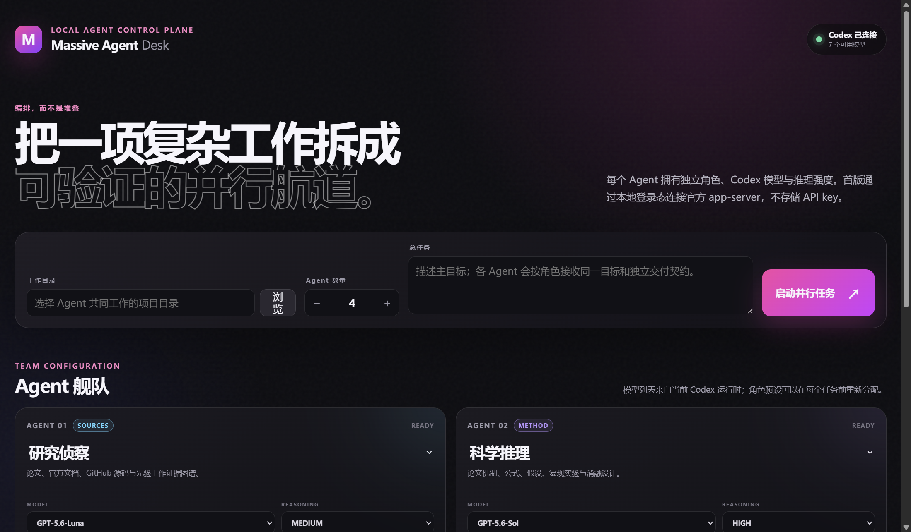
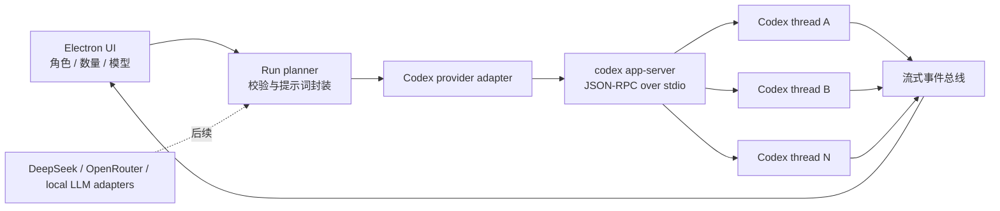

# Massive Agent Desk

一个本地优先的桌面级多 Agent 调度器。首版面向 Codex：从当前登录态启动官方 `codex app-server`，动态读取可用模型，为每个 Agent 配置角色、模型与推理强度，并把同一复杂任务分发到多个独立线程。

本仓库同时包含一套根据近期实际工作生成的全局 Codex 配置，以及可复用的 `design-personal-agent-team` Skill。



## 当前完成度

v0.1 已完成以下纵向切片：

- Electron 桌面界面，可配置 1–8 个 Agent；
- 八个长期角色预设，每个角色可以独立选择 Codex 模型和 reasoning effort；
- 通过 Codex App Server 的 JSON-RPC `initialize`、`model/list`、`thread/start`、`turn/start` 和 `turn/interrupt` 驱动真实线程；
- 实时转发 Agent 事件和输出，单个 Agent 可中断；
- 配置保存到 Electron `userData`，不进入 Git 仓库；
- 无 OpenAI API key 依赖，复用本机 Codex 登录状态；
- 纯规划逻辑单测和真实 `model/list` 握手 smoke test；
- 可安装的全局 `AGENTS.md`、`[agents]` 配置、8 个自定义 Agent 和 Skill。

## 架构



关键边界是 `provider adapter`。UI 和调度计划不依赖 Codex 私有数据结构；后续接入 DeepSeek、OpenRouter、Ollama/Lemonade 或其他 agent runtime 时，只需要实现统一的模型发现、会话启动、事件流和中断接口。

## 为什么这样设计

- [Codex App Server 官方文档](https://learn.chatgpt.com/docs/app-server)明确将 app-server 定位为深度产品集成接口，覆盖认证、历史、审批与流式事件；这比解析 CLI 终端输出稳定，也无需单独保存 API key。
- [Codex Subagents 官方文档](https://learn.chatgpt.com/docs/agent-configuration/subagents)支持个人级 `~/.codex/agents/*.toml`、并发上限、默认子 Agent 模型和角色级模型覆盖，因此全局配置与桌面端使用同一套角色语义。
- [Hermes Agent](https://github.com/NousResearch/hermes-agent)提供的可迁移启发是 provider 可替换、Skill/记忆分层、隔离子 Agent 和长期会话；本项目暂不复制其庞大功能面。
- [AutoGen Studio 论文](https://arxiv.org/abs/2408.15247)指出多 Agent 工具的主要难点是模型、工具、工作流、终止条件和调试参数过多；因此首版先保留少量关键旋钮，并让运行状态可观察。
- [MetaGPT 论文](https://arxiv.org/abs/2308.00352)表明 SOP 和明确角色有助于减少简单串联造成的级联幻觉；因此角色提示词包含证据、边界、验证和交接契约，而不只是职位名称。
- [Hydra](https://github.com/jpdlr/hydra)与 [Codeg](https://github.com/xintaofei/codeg)展示了桌面并发、会话持久化、工作树隔离和跨 provider 的产品形态。它们是竞品/先例，不是本项目运行时依赖。

## 本地运行

前提：Node.js 20+、可用的 Codex CLI，以及已经完成的 Codex 登录。

```powershell
npm install
npm test
npm run smoke:codex
npm start
```

如果 `codex` 不在 `PATH`，可以在启动前设置 `CODEX_CLI_PATH` 指向 `codex.exe`。应用只把工作流配置写到 Electron 的本地 `userData` 目录，不记录认证令牌。

## 全局配置

仓库中的 [global-config](./global-config) 是基于近期工作形成的个人配置：

| Agent | 默认模型 | 负责内容 |
|---|---|---|
| `research_scout` | GPT-5.6 Luna | 论文、官方文档、GitHub 与先验证据 |
| `scientific_reasoner` | GPT-5.6 Sol | 公式、机制、实验设计与严谨综合 |
| `ml_experimenter` | GPT-5.6 Terra | PyTorch、生成模型、训练与评估 |
| `fpga_embedded_engineer` | GPT-5.6 Terra | RTL、时序、串行协议、MCU 和上板验证 |
| `analog_instrumentation_engineer` | GPT-5.6 Terra | 模拟/RF、ADC/DAC、AGC/THD 与仪器 |
| `software_builder` | GPT-5.6 Terra | 桌面/全栈、调度、provider adapter 与打包 |
| `verification_reviewer` | GPT-5.6 Sol | 独立正确性、回归、安全与证据审计 |
| `technical_writer` | GPT-5.6 Luna | 科研报告、Word/PDF/幻灯片和视觉质检 |

安装脚本会为现有全局文件创建时间戳备份，然后安装配置与 Skill：

```powershell
powershell -ExecutionPolicy Bypass -File .\global-config\install.ps1
```

默认并发上限为 6。日常复杂任务建议 2–4 个 Agent；只有工作流确实可以拆成独立 lane 时才提高并发。

## 开发路线

### Phase 1 — Codex control plane（当前）

- 完善流式消息类型、工具调用卡片、审批请求和线程恢复；
- 增加主 Agent 汇总视图，不把“多个输出”误当成“已经整合”；
- 引入 worktree 分配，避免多个实现 Agent 同时编辑同一文件；
- 使用 app-server 生成的版本化 TypeScript schema 取代手写边界类型；
- 增加 Electron 打包、自动更新与 Windows 安装包。

### Phase 2 — 可验证的编排

- DAG/SOP 工作流编辑器：依赖、并行组、停止条件、审核闸门；
- Agent 间消息、结果引用、冲突检测和主 Agent 最终验收；
- token/延迟/成功率与测试通过率仪表盘；
- 可复用的团队模板、任务模板和回放数据；
- 对固定任务集做单 Agent、多 Agent、不同模型组合的回归评测。

### Phase 3 — 多 provider

- 定义 `ProviderAdapter`：`listModels`、`startSession`、`startTurn`、`streamEvents`、`interrupt`、`resume`；
- 接入 DeepSeek/OpenAI-compatible API、OpenRouter 和本地模型；
- 凭据进入系统密钥环或 provider 自有安全登录流程，绝不进入项目配置；
- 统一能力发现：工具调用、视觉、上下文、reasoning、价格与速率限制；
- 支持“强模型做总控 + 低成本模型做检索/格式化”的混合策略。

### Phase 4 — 长期智能团队

- 项目级记忆与可审计的经验沉淀，成熟流程自动候选为 Skill；
- 失败恢复、幂等重试、检查点和跨设备远程控制；
- 权限配置、预算、外部写入闸门与组织审计；
- 对科研、FPGA/仪器、ML 实验和文档交付分别建立领域工作流。

## 安全边界

- 首版只在本机通过 stdio 连接 app-server，不开放网络监听；
- 不保存 API key、Codex token 或 `auth.json`；
- Agent 的实际文件和网络权限仍由 Codex 的父会话/配置控制；
- 并发写操作需要文件所有权或 worktree 隔离；当前版本适合研究、分析和明确分工的实现，不应让多个 Agent 无隔离地修改同一文件；
- 外部写入、破坏性操作和成本显著的任务仍需要单独授权。
